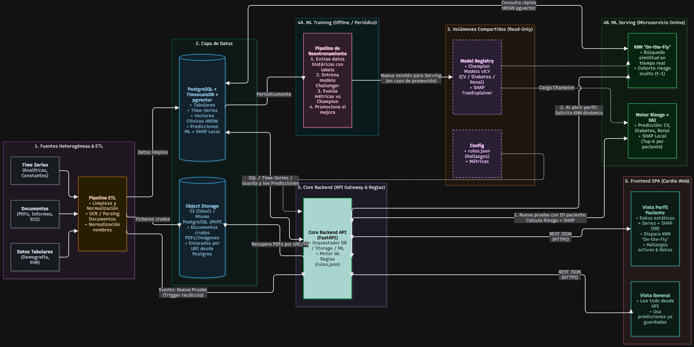

# Cardia — cardiovascular risk prioritisation for primary care

> Built in a **2-day hackathon** (Boehringer Ingelheim IT hackathon, November 2026) as a team.
> Demo with the Framingham teaching dataset plus synthetic identities and lab values — **not for clinical use**.
> [Versión en español](README.es.md)

A GP's list has thousands of patients and no time to review them all. Cardia ranks the list by **10-year cardiovascular risk**, explains *why* each patient is at risk (SHAP), raises **guideline-based findings** (ESH/ESC, ADA, KDIGO) when new lab results arrive, and shows **similar historical patients and what happened to them** (KNN).



## Highlights

| Area | What it does |
|---|---|
| **Data platform** | PostgreSQL 16 + **TimescaleDB** hypertables for exams, measurements and predictions; **pgvector** HNSW index for patient similarity |
| **Data engineering** | Per-source landing files (blood, vitals, urine) coded with **LOINC**, idempotent Python ETL, deterministic synthetic data, explicit [data contract](docs/data-contract.md) |
| **Data quality** | The database is the single source of truth: lab-report PDFs are *generated from* the DB and, on ingestion, every printed value is parsed and **verified against the DB** before the document is linked |
| **ML** | Cox proportional-hazards model with splines on the 6 SCORE2 variables, served as a separate **FastAPI microservice** with a frozen model, **exact SHAP** (all 64 coalitions) and a Champion/Challenger registry |
| **Reproducibility** | Training is rebuilt from the database with the same features: reproduces the original coefficients to ~1e-11 and the 454 held-out test predictions exactly |
| **Rules engine** | Clinical findings defined in a [JSON rule file](src/config/finding-rules.json) shared by backend (Python) and frontend (JS), tested for identical behaviour |
| **Similar patients** | KNN (k = 7) on 20 original Framingham variables, z-scored and weighted, one embedding per patient state |
| **Developer experience** | One-command setup on Windows/macOS/Linux, Docker Compose, GitHub Actions CI, 94 automated tests |

## Quick start

**Docker Compose** (needs Docker and the Framingham CSV at `data/raw.csv`, which is not versioned):

```sh
docker compose --profile init run --rm init   # first time: schema, ETL, findings, KNN index, risk backfill (~15 min)
docker compose up -d                          # db, risk engine, backend, frontend
```

Frontend http://localhost:5173 · API docs http://localhost:8000/docs · Risk engine http://localhost:8001/docs

**One-command local setup** (installs uv and the right Python, starts everything, also generates the lab PDFs): `setup.cmd` on Windows or `./setup.sh` on macOS/Linux. See [README.es.md](README.es.md) for options.

## Repository layout

```
db/            SQL schema (TimescaleDB hypertables, pgvector index) and smoke test
backend/       FastAPI Core API
  app/etl/        source builders and loader (LOINC → indicators)
  app/jobs/       batch jobs: load, findings, KNN index, lab PDFs, risk backfill
  app/knn/        feature engineering and similarity search
  app/documents/  PDF parser, verified ingestion, storage backend
ml/            Risk engine: model registry, serving (service.py), training from the DB, SHAP
  experiments/coxph/  agentic pipeline search that found the provisional champion
src/           Frontend (vanilla JS ES modules, no build step) and shared clinical config
scripts/       bootstrap (one-command setup), dev server with /api proxy, checks
```

## Design decisions

- **Separate risk-engine service.** The model needs pinned scientific libraries (Python 3.12, scikit-learn 1.9.1, scipy 1.18) to unpickle; isolating it keeps the API light and makes the model swappable. It receives only the 6 clinical features — no identities.
- **Database as source of truth, PDFs as a derived artefact.** Mirrors a real lab integration (LIS → PDF) while guaranteeing the document never disagrees with the data.
- **Time-series first.** Clinical measurements are append-only and queried by patient and time, so TimescaleDB hypertables fit naturally; the KNN state is computed "as of" each test so no future data leaks in.
- **Rules as data.** Clinicians can add or tune findings without code changes; the same file drives backend and frontend.
- **Validated equations over custom models where data is missing.** Framingham has no kidney outcomes, so kidney-risk prediction is planned with published equations (KFRE, CKD-PC) instead of training on unsuitable data.

## About `ml/experiments/coxph/code/`

These `candidate_XXX.py` files are the output of an **agentic pipeline search**: an LLM-driven loop that proposed, trained and scored survival pipelines. The best one became the provisional champion (`best_pipeline.py`) before the scheduled retraining architecture was in place. They are kept as an audit trail of the search; see [its README](ml/experiments/coxph/README.md).

## My role (Pau Gibert)

**System architecture and data/ML platform.** I designed the overall architecture and built most of the platform around it: the database, the backend API, the model-serving layer and the setup tooling.

- **Data layer:** PostgreSQL/TimescaleDB/pgvector schema, per-source landing files with LOINC mapping, idempotent ETL and deterministic synthetic data.
- **Core API:** FastAPI backend with the guideline-based rules engine (v2: ESH/ESC, ADA, KDIGO), shared with the frontend.
- **Similar patients:** point-in-time feature engineering and KNN search on pgvector.
- **Lab reports:** PDFs generated from the database, then parsed and verified against it on ingestion.
- **Model serving:** put the CoxPH model trained by a teammate into production as a microservice with exact SHAP explanations and a Champion/Challenger model registry, reading its data from the database.
- **Developer experience:** one-command setup on every OS, Docker Compose and CI.

**Modelling strategy.** I proposed the strategy for finding the model, an agentic pipeline search over survival models. A teammate ran the search and trained the model.

**Frontend.** The UI/UX was designed and built by teammates. I gave feedback on it, connected it to the backend API (data adapter, risk explanations, similar-patients card, one timeline event per test) and implemented a round of UI refinements.

## Roadmap (not done in the 2 days)

| Now | Next |
|---|---|
| Batch jobs run by the setup script | Orchestrator (Dagster / Airflow) with scheduled retraining and data-quality checks |
| `registry.json` + joblib Champion/Challenger | MLflow model registry and experiment tracking; drift and calibration monitoring |
| Pickled model pinned to library versions | Portable format (ONNX) or retrain-on-deploy |
| No authentication, local credentials | OIDC SSO + RBAC per GP list, access audit log, secrets manager, TLS |
| Identity and clinical data in one schema | Pseudonymisation (separate identity store), de-identified training views |
| Custom JSON API | HL7 FHIR (`Patient`, `Observation`, `DiagnosticReport`), SNOMED CT |
| Cardiovascular risk only | Kidney risk: KDIGO heat-map card, KFRE (2/5-year kidney failure), CKD-PC incident CKD |

## Limitations

The risk model (test AUC 0.66) is trained on a teaching dataset and is not clinically validated. Renal labs, identities and contact details are synthetic. Rule thresholds are illustrative.
